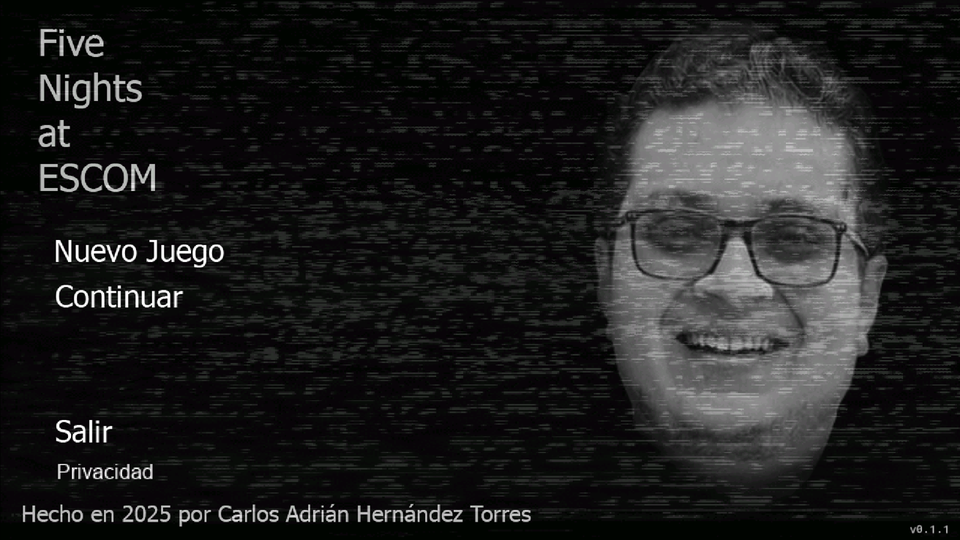
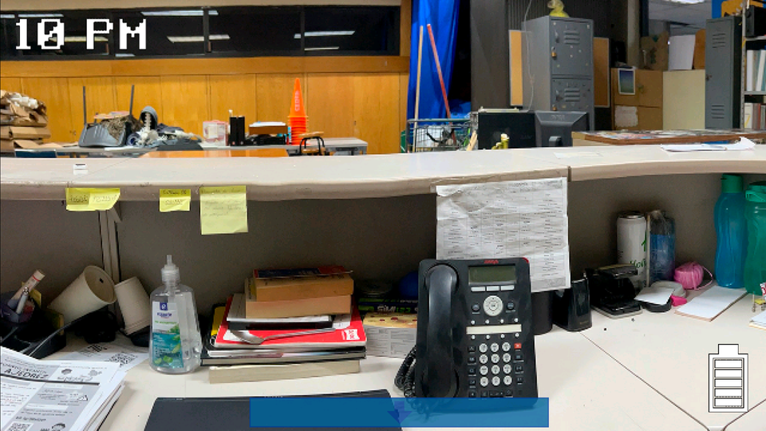
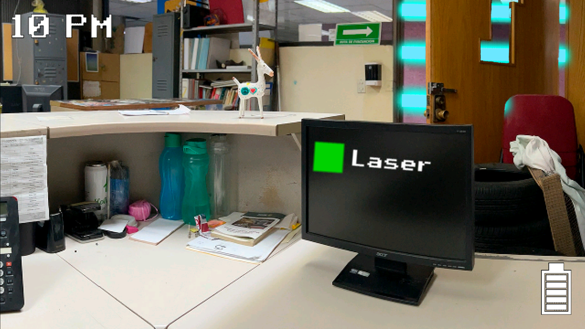
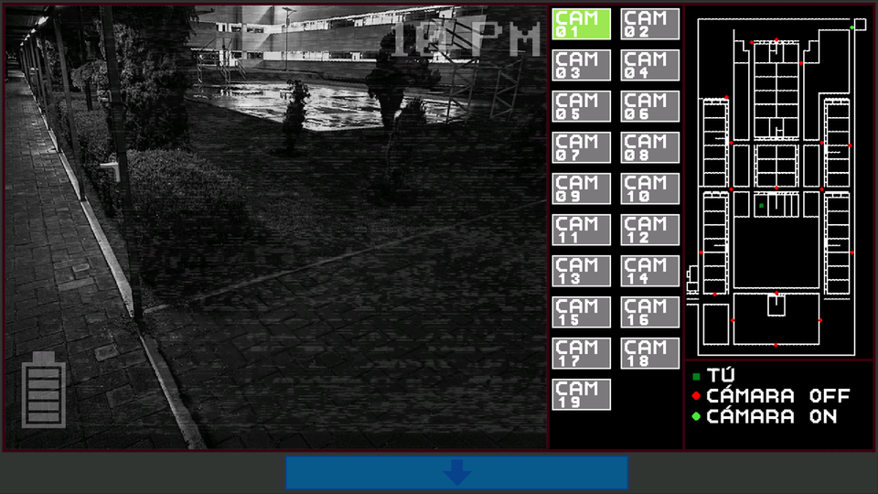
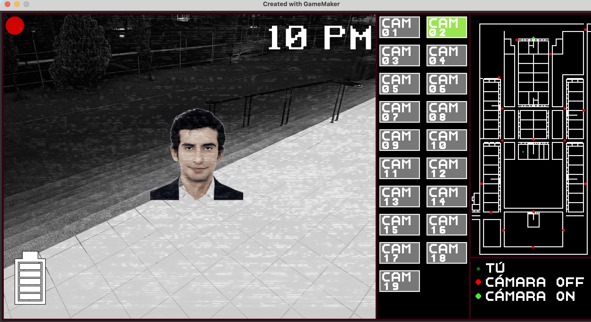
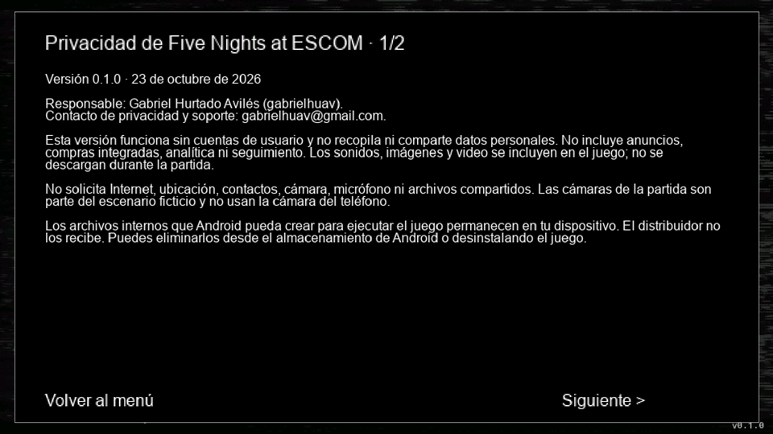

<p align="center">
  
</p>

# Five Nights at ESCOM

Juego de terror y supervivencia hecho en **GameMaker** y ambientado en la ESCOM (IPN). Cuidas la oficina de seguridad de 10 PM a 6 AM: vigilas las cámaras, activas el láser y administras la batería para que no te alcancen.

Proyecto original (2025) de **Carlos Adrián Hernández Torres**. Este fork lo continúa **Gabriel Hurtado Avilés** ([@gabrielhuav](https://github.com/gabrielhuav)), con el permiso del autor, como proyecto de la materia *Aplicaciones Móviles Nativas* (ESCOM, grupo 7CV4). Los alumnos agregan funciones mediante Pull Requests.

## Google Play

El juego está en una **prueba cerrada** (pista Alpha, México) y sólo pueden instalarlo las cuentas inscritas en la lista de testers del curso.

| | |
|---|---|
| Paquete | `ovh.gabrielhuav.fivenightsatescom` |
| Unirse a la prueba | <https://play.google.com/apps/testing/ovh.gabrielhuav.fivenightsatescom> |
| Ficha en Play Store | <https://play.google.com/store/apps/details?id=ovh.gabrielhuav.fivenightsatescom> |
| Política de privacidad | <https://gabrielhuav.github.io/Five-Nights-at-ESCOM/privacy/> |

Cada alumno acepta la invitación e instala el juego con la **misma cuenta de Google** que está registrada en la lista.

### Versiones

| Versión (código) | Commit | Contenido | Estado |
|---|---|---|---|
| 0.1.0 (1000) | [`5808e2c`](https://github.com/gabrielhuav/Five-Nights-at-ESCOM/commit/5808e2cb625a4474795ee57045965a12ba40d076) | Primera versión Android: Noche 1, aviso de privacidad sin conexión, ícono rojo de pixel art y permisos mínimos | Enviada el 24 oct 2026; disponible en la prueba cerrada |
| 0.1.1 (1001) | [`0adaaaa`](https://github.com/gabrielhuav/Five-Nights-at-ESCOM/commit/0adaaaab73c1bdc666d347904d1fdbdf3878a52c) | Noche 2 con el Intruso, guardado de progreso y botón **Continuar** | Enviada a revisión el 7 nov 2026; el propietario informó su lanzamiento el 8 nov 2026 |
| Desarrollo (`main`) | — | 0.1.1 + menú de pausa, apagón por batería y atajo de noche ([PR #2](https://github.com/gabrielhuav/Five-Nights-at-ESCOM/pull/2)); en revisión: panel de Opciones y pausa táctil ([PR #6](https://github.com/gabrielhuav/Five-Nights-at-ESCOM/pull/6)) | Sin compilar ni publicar |

Requiere Android 7.0 (API 24) o posterior; objetivo API 36, ARM64. No tiene anuncios, cuentas, compras ni permisos de red: el progreso se guarda sólo en el dispositivo (`progreso.ini`).

## Capturas

| | |
|---|---|
|  |  |
| Menú de la 0.1.1 con **Continuar** habilitado tras superar la Noche 1. | La oficina al comenzar la Noche 1 (10 PM). |
|  |  |
| Control táctil del láser. | Vigilancia: 19 cámaras, mapa y batería. |
|  |  |
| Noche 2: el Intruso en el sistema de cámaras (evidencia del PR #4, Windows). | Aviso de privacidad que funciona sin conexión. |

Todas son capturas reales del juego: Galaxy S22+ durante la prueba de la 0.1.1 (7 nov 2026), recursos de la ficha de Play y evidencia del PR #4. La procedencia de cada imagen está en [docs/capturas/readme/README.md](docs/capturas/readme/README.md).

## Cómo se juega

- **Sobrevive hasta las 6 AM.** El reloj avanza desde las 10 PM; al llegar a las 6 AM ganas la noche.
- **Vigila.** Abre las cámaras y elige entre CAM 01 y CAM 19 para ubicar a los enemigos en el mapa.
- **Defiéndete.** El láser protege la oficina. Tanto el láser como las cámaras gastan batería.
- **Cuida la batería.** En la 0.1.1, sin batería se apagan cámaras y láser. En `main` (PR #2, aún no publicado) agotarla provoca un apagón, el susto y Game Over.
- **Noche 2.** Prismoso sigue activo y aparece el **Intruso**: empieza en la cámara 1 y avanza una cámara cada 10 segundos si no lo estás mirando; si llega a la cámara 8, te atrapa.
- **Continuar.** Al ganar la Noche 1 se guarda el progreso y el menú habilita **Continuar**, que lleva directo a la Noche 2.

### Controles

| Acción | Android (táctil) y Windows (ratón) | Teclado (sólo Windows, en `main`) |
|---|---|---|
| Abrir o cerrar cámaras | Barra azul inferior | — |
| Cambiar de cámara | Botones CAM 01–19 | — |
| Láser | Botón del láser | — |
| Pausar o reanudar | Botón de pausa (arriba, a la izquierda del centro) y «Reanudar» | ESC o P |
| Salir al menú desde la pausa | Botón «Salir al Menú» | — |
| Completar la noche (atajo de prueba) | — | Ctrl + Shift + N |

## Abrir y ejecutar el proyecto

1. Instala **GameMaker LTS 2026** (IDE 2026.0.0.16, runtime 2026.0.0.23).
2. Clona el repositorio:

   ```bash
   git clone https://github.com/gabrielhuav/Five-Nights-at-ESCOM.git
   ```

3. Abre `Five Nights at ESCOM.yyp` en GameMaker.
4. Para una prueba rápida, elige el destino **Windows** y pulsa Run (F5).
5. Para Android, configura en GameMaker el Android SDK (build-tools 36), el NDK 30.0.16248370 y un JDK 21. La compilación que se sube a Play la firma el propietario con su llave de carga: **nunca subas llaves ni contraseñas al repositorio**.

Validación estática (también corre en GitHub Actions; no compila el juego):

```bash
python tools/validate_project.py
```

## Cómo contribuir

- Trabaja en tu fork, en una rama `feature/...`, y abre el PR hacia `main` de **gabrielhuav/Five-Nights-at-ESCOM**, no hacia el repositorio original.
- Guarda los cambios desde el IDE de GameMaker. No reformatees a mano ni con scripts los `.yy`, el `.yyp` o el `.resource_order`: GameMaker escribe comas finales y, en las salas, una instancia por línea. Si se reescriben, aparecen miles de líneas de diferencia y conflictos.
- No crees archivos cuyo nombre sólo cambie en mayúsculas (`LICENCIAS.md` y `licencias.md`): Windows no los distingue.
- Lo que vaya a Android debe funcionar con controles táctiles.
- Documenta las pruebas con evidencias en `docs/` y ejecuta el validador antes de pedir revisión.

## Historial de integración

| Cambio | Autores | Estado |
|---|---|---|
| Juego base: Noche 1, cámaras, láser, batería, victoria y derrota | Carlos Adrián Hernández Torres | Original (2025) |
| [PR #4](https://github.com/gabrielhuav/Five-Nights-at-ESCOM/pull/4): Noche 2, Intruso, guardado y Continuar | Ximena Moreno Noguerón, José Abel Reyes Castellanos, Jonathan Chávez Romero | Integrado el 29 oct 2026; publicado en la 0.1.1 |
| Preparación Android y Google Play (privacidad, ícono, paquete, permisos, firma) | Gabriel Hurtado Avilés | Publicado en 0.1.0 y 0.1.1 |
| [PR #2](https://github.com/gabrielhuav/Five-Nights-at-ESCOM/pull/2): menú de pausa, apagón por batería y atajo Ctrl+Shift+N | Luis Ángel Agustín Fuentes (pausa), Alexis Hernández (apagón y atajo) | Integrado en `main` el 8 nov 2026; no publicado |

Los detalles de la integración del PR #2 están en [docs/integracion-pr-2.md](docs/integracion-pr-2.md).

### Participantes de la Entrega 1 (Noche 2)

* Chávez Romero Jonathan - 2024630102
* Moreno Noguerón Ximena - 2024630201
* Reyes Castellanos José Abel - 2020311353

## Documentación

| Tema | Archivo |
|---|---|
| Reglas para personas e IAs que trabajen en el repositorio | [AGENTS.md](AGENTS.md) |
| Estado de Google Play y guía de la siguiente actualización | [docs/publicacion/ACTUALIZACION_PLAY_STORE.md](docs/publicacion/ACTUALIZACION_PLAY_STORE.md) |
| Política de privacidad (fuente publicada con GitHub Pages) | [docs/privacy/index.html](docs/privacy/index.html) |
| Créditos y licencias | [AUTHORS.md](AUTHORS.md) · [docs/LICENCIAS.md](docs/LICENCIAS.md) |
| Entrega 1 (Noche 2): idea, pruebas y evidencias | [IDEA](docs/evidencias/entrega1/IDEA.md) · [PRUEBAS](docs/evidencias/entrega1/PRUEBAS.md) · [ENTREGA1](docs/evidencias/entrega1/ENTREGA1.md) |
| PR #2: idea, diseño, arquitectura y pruebas | [Idea](docs/idea.md) · [Diseño](docs/diseno/README.md) · [Arquitectura](docs/arquitectura.md) · [Pruebas](docs/pruebas.md) · [Atajo](docs/pruebas-atajo.md) · [Evidencias](docs/evidencia/entrega-1/README.md) |

## Licencia

El repositorio aún no declara una licencia de código abierto. Consulta [AUTHORS.md](AUTHORS.md) y [docs/LICENCIAS.md](docs/LICENCIAS.md) antes de reutilizar código o recursos.
